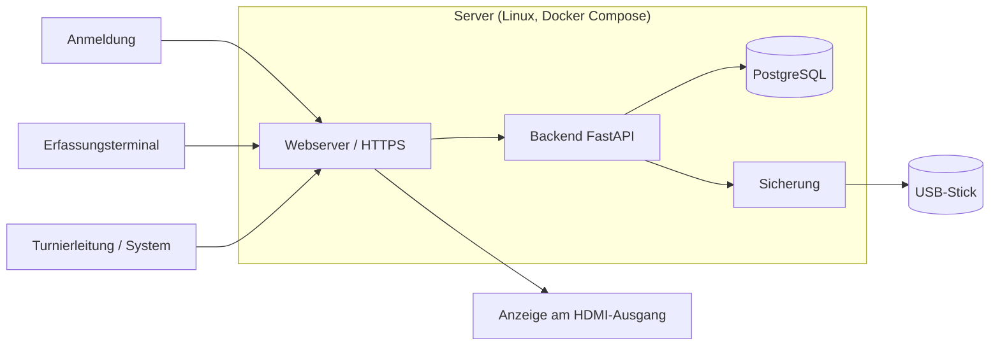

# Architektur

Schiesshub läuft auf einem kleinen Linux-Rechner im Schützenhaus. Er ist Datenbank, Backend und Webserver in einem. Alle Stationen sind Webseiten, die Clients im lokalen Netz im Browser öffnen. Internet ist zur Laufzeit nicht nötig.



## Grundsätze

1. **Nichts fest verdrahten.** Disziplinen, Klassen, Startgeld, Mehrfachstart, Rollen, Anzeige und Sicherung sind Daten oder Einstellungen.
2. **Der Start ist die zentrale Einheit.** Ein Teilnehmer bucht Starts in Wettbewerben. Ergebnis, Betrag und Schützenstand hängen am Start.
3. **Die Wertung rechnet nur der Server.** Das Erfassungsterminal schickt Rohwerte und zeigt die Summen, die zurückkommen. So gibt es jede Formel genau einmal.
4. **Ergebnisse werden nie überschrieben.** Jede Eingabe und jede Korrektur ist ein Ereignis mit Benutzer, Zeit und Grund.
5. **Offline zuerst.** Keine Cloud, kein CDN, keine Telemetrie.
6. **Datensparsam.** Kein Geburtsdatum. Namen liegen verschlüsselt in der Datenbank.

## Verzeichnisse

```text
backend/     Python, FastAPI, SQLAlchemy, Alembic
frontend/    React, TypeScript, Vite, Mantine
catalog/     Disziplin-Katalog (YAML), wird beim Start eingelesen
deploy/      Docker-Dateien für den Server
docs/        diese Dokumentation
```

## Backend

- **FastAPI** mit Pydantic-Schemas. Die OpenAPI-Beschreibung ist die Schnittstelle zum Frontend; der TypeScript-Client wird daraus erzeugt.
- **PostgreSQL** über SQLAlchemy 2 (async), Migrationen mit Alembic. Migrationen laufen beim Start automatisch.
- **Live-Updates** über Server-Sent Events (`GET /api/v1/events`). Clients laden bei einem Ereignis die betroffenen Daten neu. `GET /api/v1/events/names` nennt alle Ereignisnamen, die vorkommen können (Browser hören nur auf genaue Namen).
- **Module:** Jedes Fachgebiet ist ein Paket unter `backend/app/modules/<name>/` mit eigenem Router, Modellen, Schemas und Service. Ein Modul meldet sich über ein kleines Manifest an (Name, Router, Berechtigungen). Zusätzliche Module können später als eigene Python-Pakete dazukommen.

Kernmodule der ersten Version:

| Modul | Aufgabe |
|---|---|
| `katalog` | YAML-Katalog einlesen und bereitstellen |
| `turnier` | Turnier, Wettbewerbe, Klassen, Einstellungen |
| `teilnehmer` | Personen, Vereine, Import und Export |
| `starts` | Anmeldung, Starts, Reihenfolge am Schießstand |
| `ergebnisse` | Erfassung, Ereignisprotokoll, Wertung, Ranglisten |
| `anzeige` | Inhalt und Einstellungen der öffentlichen Anzeige |
| `export` | Startliste und Ergebnisliste als PDF und CSV |
| `auth` | Geräte, Personen, Rollen, Berechtigungen |
| `system` | Sicherung, Zertifikat, Status, formelle Begriffe je Verband (`GET /api/v1/terms`) |

## Frontend

- **React + Vite + TypeScript**, Oberfläche mit **Mantine**. In der Entwicklung läuft Vite lokal mit Hot Reload und leitet `/api` an das Backend im Container weiter.
- **Hell und dunkel**, Auswahl je Nutzer. Farben und Schriften kommen aus einem zentralen Theme.
- **Mehrsprachig vorbereitet:** Alle Texte liegen in Sprachdateien (Start: Deutsch).
- **Stationen** sind eigene Bereiche: Anmeldung, Turnier, Erfassung, Anzeige, System. Welche ein Gerät sieht, bestimmt die Rolle.

## Wertung

Der Katalog beschreibt je Disziplin den Ablauf (Abschnitte, Serien, Schusszahlen, Zeiten) und das Wertungsmodell. Das Backend baut daraus die Eingabemaske und rechnet das Ergebnis.

| Modell | Rohwerte | Ergebnis |
|---|---|---|
| `ringe` | Ringwert je Schuss oder Summe je Serie | Summe, höher ist besser |
| `ringe_minus_zeit` | Ringe und Zeit je Serie | Ringe minus Sekunden |
| `ringe_mit_zeitabzug` | Ringe, Gesamtzeit | Ringe minus Abzug über Sollzeit |
| `zeit_plus_zuschlaege` | Zeit und stehende Scheiben je Serie | Zeit plus Zuschläge, niedriger ist besser |

Zeiten werden in Hundertstelsekunden gespeichert. Im Turnier kann jeder Katalogwert überschrieben werden; gespeichert wird dann eine Kopie am Wettbewerb.

### Abbruch durch den Schützen

Wie Sporthandbuch K 1.14 / L 1.12: Wer nach dem Kommando „Feuer“ abbricht (Abbruchgrund „aufgegeben“, mindestens ein Wertungswert erfasst), wird nach dem bis dahin erzielten Ergebnis platziert – in der normalen Rangfolge, gekennzeichnet mit „Abbruch (AB)“. Nicht geschossene Serien zählen nach der Regel des Wertungsmodells (`app.scoring.compute_aborted`):

| Modell | Nicht geschossene Serie | Teilweise erfasste Serie |
|---|---|---|
| `ringe` | 0 Ringe (kein Nachholen, A 9.08) | fehlende Schüsse 0 Ringe |
| `ringe_mit_zeitabzug` | 0 Ringe; fehlt die Gesamtzeit eines Abschnitts mit Sollzeit, zählt er nur, wenn seine Ringe nicht über `min_teilergebnis` liegen | fehlende Schüsse 0 Ringe |
| `zeit_plus_zuschlaege` | wie Abbruch durch den Schützen: `zeit_bei_abbruch_s` plus Zuschlag für jede Scheibe (alle stehen); ohne `zeit_bei_abbruch_s` fehlt die Regel | nicht wertbar (Status der Serie erfassen) |
| `ringe_minus_zeit` | Regel fehlt (keine Zeit des letzten Schusses) | zählt, wenn die Zeit erfasst ist |

Fehlt eine Regel oder ist eine Serie nicht wertbar, bleibt der Start ohne Platz mit dem Hinweis „Ergebnis nicht vergleichbar: …“. Ohne Platz bleiben außerdem nicht angetreten, disqualifiziert und ein Abbruch ohne Wertungswert (Abbruch im Probeschießen, „AB“). Das gewertete Ergebnis rechnet die Rangliste beim Lesen aus Rohwerten und aktueller Definition; gespeichert bleibt der Zwischenstand der Erfassung. Rangliste, Anzeige und Export nutzen dieselbe Funktion (`ergebnisse.ranking`). Bei Mehrfachstart zählt ein platzierter Abbruch wie ein reguläres Ergebnis. Formelle Wörter der Listen (Ergebnisliste, Abbruch (AB), Ringgleichheit, Schützenstand, Schießstand) stehen in `app/modules/ergebnisse/begriffe.py`.

## Ablauf am Schießstand

Wie geplant wird, ist **je Wettbewerb einstellbar**:

| Planung | Wann sinnvoll | Was die App tut |
|---|---|---|
| Reihenfolge | Dauer nicht vorhersehbar, zum Beispiel Fallscheibe: ein Durchgang dauert Sekunden oder Minuten | Wartende Starts stehen in einer Reihenfolge, die Standaufsicht ruft den nächsten auf |
| Zeitplan | Disziplinen mit fester Schießzeit, zum Beispiel Präzision mit 2×10 Schuss in je 5 Minuten | Durchgänge mit Uhrzeit und Schützenstand, die Anmeldung bucht einen freien Platz |

Die Voreinstellung leitet der Server aus dem Katalog ab: Haben alle Abschnitte eines Ablaufs eine feste Zeit je Serie, ist der Wettbewerb planbar. Die Durchgangsdauer ergibt sich dann aus den Serienzeiten plus einer einstellbaren Wechselzeit (Scheibenwechsel, Trefferaufnahme). Sonst gilt die Reihenfolge. Beides lässt sich im Turnier überschreiben, auch die berechnete Dauer.

Teilen sich mehrere Wettbewerbe einen Schießstand, können beide Planungsarten nebeneinander vorkommen; die Belegung der Schützenstände gehört zum Schießstand, nicht zum Wettbewerb.

In beiden Fällen durchläuft ein Start dieselben Zustände:

| Status eines Starts | Bedeutung |
|---|---|
| angemeldet | gebucht, wartet |
| aufgerufen | einem Schützenstand zugeteilt, noch keine Eingabe |
| erfasst | Rohwerte (auch teilweise) eingegeben |
| abgeschlossen | Ergebnis bestätigt, erscheint in der Wertung |
| abgebrochen | nicht angetreten, aufgegeben oder disqualifiziert |

Ein Schützenstand ist belegt, solange ein aufgerufener Start darauf steht – auch noch, wenn schon erfasst wird, denn der Schütze schießt ja noch. Frei wird er, wenn das Ergebnis abgeschlossen oder der Start abgebrochen oder zurückgestellt wird, oder ausdrücklich über „Schützenstand freigeben“ (etwa wenn der Schütze fertig ist, das Ergebnis aber noch nicht abgeschlossen wird). Ein Start, der ohne Aufruf nachträglich erfasst wird, belegt keinen Schützenstand.

Die Standaufsicht ruft die nächsten Starts auf die freien Schützenstände („Nächste aufrufen“ oder „Nächsten auf Schützenstand N“, beides `POST …/ranges/{id}/call-next`, das zweite mit `lane`). Eine Person steht nie auf zwei Schützenständen zugleich: Wer gerade irgendwo auf einem Schützenstand steht, auch an einem anderen Schießstand, wird übersprungen, behält seinen Platz in der Reihenfolge und wird in der Antwort genannt. Reihenfolge und „am Schießstand“ zeigen je belegtem Schützenstand den Status und, sobald erfasst wird, den Fortschritt (Abschnitt x von y, erfasste Serien im Abschnitt und über alle Abschnitte); die Standanzeige hebt damit die laufende Serie im Ablauf hervor.

Teilen sich Zeitplan und Reihenfolge einen Schießstand, hält ein Durchgang die gebuchten Schützenstände seiner wartenden Starts frei, sobald er innerhalb einer einstellbaren Frist beginnt (Turnier-Einstellung `heat_reserve_minutes`, Standard 10 Minuten, 0 = aus), bis er vorbei ist. Ein Aufruf aus der Reihenfolge belegt ohne Rückfrage nur Schützenstände, die der Durchgang nicht braucht; „Nächste aufrufen“ lässt die übrigen frei und meldet sie. Wäre nur auf freigehaltenen Schützenständen jemand drangekommen, lehnt der Server mit 409 und `code: heat_imminent` ab (Uhrzeit und Schützenstände im Text); mit `confirm_heat_conflict: true` wird trotzdem aufgerufen. Reihenfolge und „am Schießstand“ nennen den nächsten Durchgang mit seinen Schützenständen (`upcoming_heat`), damit die Oberfläche vorab warnen kann.

Die Standanzeige zeigt „am Schießstand“ und „als Nächstes“ je Wettbewerb getrennt: beim Zeitplan nur die Starts des nächsten Durchgangs mit Durchgangsnummer, Uhrzeit (Ortszeit des Turniers, Einstellung `timezone`) und Schützenstand, bei der Reihenfolge den Platz in der Reihenfolge. Wer gerade auf einem Schützenstand steht, bleibt dort sichtbar und wird gekennzeichnet. Wettbewerbe erscheinen in allen Stand-Sichten und auf der Anzeige mit der Kennziffer der Disziplin (`competition_code`), damit gleichnamige Wettbewerbe unterscheidbar sind.

Einen Start abbrechen (nicht angetreten, aufgegeben, disqualifiziert) ist ein eigenes Recht (`start.abort`), getrennt vom Aufrufen (`start.call`).

## Sicherheit und Daten

- **Anmeldung:** Geräte werden per QR-Code gekoppelt. Personen melden sich mit einer PIN an. Rollen sind frei definierbare Sammlungen von Berechtigungen; fünf Startrollen sind vorbelegt.
- **HTTPS im lokalen Netz:** Der Server erzeugt beim ersten Start eine eigene Zertifizierungsstelle und ein Serverzertifikat. Eine Seite in der App bietet das Stammzertifikat zum Herunterladen an, mit Anleitung je Betriebssystem. In der Entwicklung läuft alles über `http://localhost`.
- **Namen verschlüsselt:** Personenbezogene Felder werden vor dem Speichern mit AES-GCM verschlüsselt. Der Schlüssel liegt außerhalb der Datenbank auf dem Server.
- **Sicherung:** Regelmäßige Datenbank-Abzüge plus eine laufende Mitschrift aller Ergebnis-Ereignisse. Beides wird erst lokal geschrieben, dann verschlüsselt auf den USB-Stick kopiert. Zum Wiederherstellen braucht man das Sicherungspasswort, das bei der Einrichtung festgelegt wird. Fehlt der Stick, warnt die App.
- **Einspruchsfrist:** Einstellung je Turnier (`protest_minutes`); Ergebnisse gelten bis zum Ablauf als vorläufig. Ob eine Korrektur die Frist neu beginnen lässt, ist ebenfalls einstellbar (`protest_restart_on_correction`, Standard: ja).

Offene Punkte stehen in der [Roadmap](ROADMAP.md).
