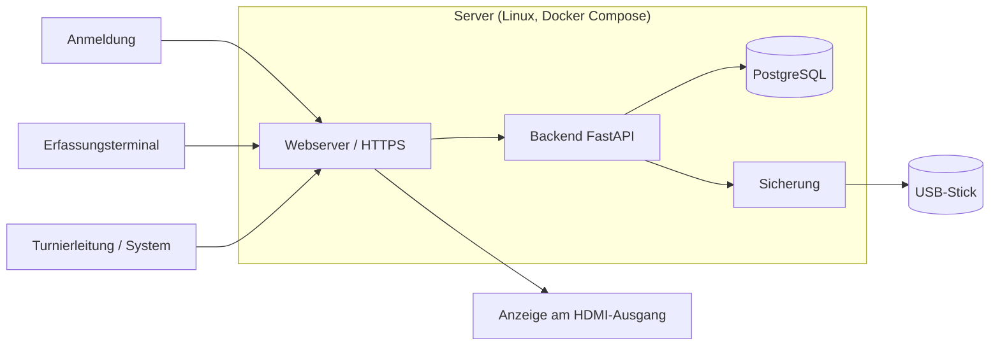

# Architektur

Schiesshub läuft auf einem kleinen Linux-Rechner im Schützenhaus. Er ist Datenbank, Backend und Webserver in einem. Alle Stationen sind Webseiten, die Clients im lokalen Netz im Browser öffnen. Internet ist zur Laufzeit nicht nötig.



## Grundsätze

1. **Nichts fest verdrahten.** Disziplinen, Klassen, Startgeld, Mehrfachstart, Rollen, Anzeige und Sicherung sind Daten oder Einstellungen.
2. **Der Start ist die zentrale Einheit.** Ein Teilnehmer bucht Starts in Wettbewerben. Ergebnis, Betrag und Bahn hängen am Start.
3. **Die Wertung rechnet nur der Server.** Das Erfassungsterminal schickt Rohwerte und zeigt die Summen, die zurückkommen. So gibt es jede Formel genau einmal.
4. **Ergebnisse werden nie überschrieben.** Jede Eingabe und jede Korrektur ist ein Ereignis mit Benutzer, Zeit und Grund.
5. **Offline zuerst.** Keine Cloud, kein CDN, keine Telemetrie.
6. **Datensparsam.** Kein Geburtsdatum. Namen liegen verschlüsselt in der Datenbank.

## Verzeichnisse

```text
backend/     Python, FastAPI, SQLAlchemy, Alembic
frontend/    React, TypeScript, Vite, Mantine
catalog/     Disziplin-Katalog (YAML), wird beim Start eingelesen
deploy/      Docker-Dateien für den Server
docs/        diese Dokumentation
```

## Backend

- **FastAPI** mit Pydantic-Schemas. Die OpenAPI-Beschreibung ist die Schnittstelle zum Frontend; der TypeScript-Client wird daraus erzeugt.
- **PostgreSQL** über SQLAlchemy 2 (async), Migrationen mit Alembic. Migrationen laufen beim Start automatisch.
- **Live-Updates** über Server-Sent Events (`GET /api/v1/events`). Clients laden bei einem Ereignis die betroffenen Daten neu.
- **Module:** Jedes Fachgebiet ist ein Paket unter `backend/app/modules/<name>/` mit eigenem Router, Modellen, Schemas und Service. Ein Modul meldet sich über ein kleines Manifest an (Name, Router, Berechtigungen). Zusätzliche Module können später als eigene Python-Pakete dazukommen.

Kernmodule der ersten Version:

| Modul | Aufgabe |
|---|---|
| `katalog` | YAML-Katalog einlesen und bereitstellen |
| `turnier` | Turnier, Wettbewerbe, Klassen, Einstellungen |
| `teilnehmer` | Personen, Vereine, Import und Export |
| `starts` | Anmeldung, Starts, Reihenfolge am Stand |
| `ergebnisse` | Erfassung, Ereignisprotokoll, Wertung, Ranglisten |
| `anzeige` | Inhalt und Einstellungen der öffentlichen Anzeige |
| `export` | Startliste und Siegerliste als PDF und CSV |
| `auth` | Geräte, Personen, Rollen, Berechtigungen |
| `system` | Sicherung, Zertifikat, Status |

## Frontend

- **React + Vite + TypeScript**, Oberfläche mit **Mantine**. In der Entwicklung läuft Vite lokal mit Hot Reload und leitet `/api` an das Backend im Container weiter.
- **Hell und dunkel**, Auswahl je Nutzer. Farben und Schriften kommen aus einem zentralen Theme.
- **Mehrsprachig vorbereitet:** Alle Texte liegen in Sprachdateien (Start: Deutsch).
- **Stationen** sind eigene Bereiche: Anmeldung, Turnier, Erfassung, Anzeige, System. Welche ein Gerät sieht, bestimmt die Rolle.

## Wertung

Der Katalog beschreibt je Disziplin den Ablauf (Abschnitte, Serien, Schusszahlen, Zeiten) und das Wertungsmodell. Das Backend baut daraus die Eingabemaske und rechnet das Ergebnis.

| Modell | Rohwerte | Ergebnis |
|---|---|---|
| `ringe` | Ringwert je Schuss oder Summe je Serie | Summe, höher ist besser |
| `ringe_minus_zeit` | Ringe und Zeit je Serie | Ringe minus Sekunden |
| `ringe_mit_zeitabzug` | Ringe, Gesamtzeit | Ringe minus Abzug über Sollzeit |
| `zeit_plus_zuschlaege` | Zeit und stehende Scheiben je Serie | Zeit plus Zuschläge, niedriger ist besser |

Zeiten werden in Hundertstelsekunden gespeichert. Im Turnier kann jeder Katalogwert überschrieben werden; gespeichert wird dann eine Kopie am Wettbewerb.

## Ablauf am Stand

Feste Startzeiten gibt es nicht. Jeder Stand hat eine **Reihenfolge** der wartenden Starts.

| Status eines Starts | Bedeutung |
|---|---|
| angemeldet | gebucht, wartet |
| aufgerufen | einer Bahn zugeteilt, schießt gerade |
| erfasst | Rohwerte eingegeben |
| abgeschlossen | Ergebnis bestätigt, erscheint in der Wertung |
| abgebrochen | nicht angetreten, aufgegeben oder disqualifiziert |

Die Standaufsicht ruft die nächsten Starts auf eine freie Bahn. Die Anzeige zeigt „am Stand“ und „als Nächstes“ aus dieser Reihenfolge.

## Sicherheit und Daten

- **Anmeldung:** Geräte werden per QR-Code gekoppelt. Personen melden sich mit einer PIN an. Rollen sind frei definierbare Sammlungen von Berechtigungen; fünf Startrollen sind vorbelegt.
- **HTTPS im lokalen Netz:** Der Server erzeugt beim ersten Start eine eigene Zertifizierungsstelle und ein Serverzertifikat. Eine Seite in der App bietet das Stammzertifikat zum Herunterladen an, mit Anleitung je Betriebssystem. In der Entwicklung läuft alles über `http://localhost`.
- **Namen verschlüsselt:** Personenbezogene Felder werden vor dem Speichern mit AES-GCM verschlüsselt. Der Schlüssel liegt außerhalb der Datenbank auf dem Server.
- **Sicherung:** Regelmäßige Datenbank-Abzüge plus eine laufende Mitschrift aller Ergebnis-Ereignisse. Beides wird erst lokal geschrieben, dann verschlüsselt auf den USB-Stick kopiert. Zum Wiederherstellen braucht man das Sicherungspasswort, das bei der Einrichtung festgelegt wird. Fehlt der Stick, warnt die App.
- **Einspruchsfrist:** Als Einstellung je Turnier vorgesehen; Ergebnisse gelten bis zum Ablauf als vorläufig.

Offene Punkte stehen in der [Roadmap](ROADMAP.md).
