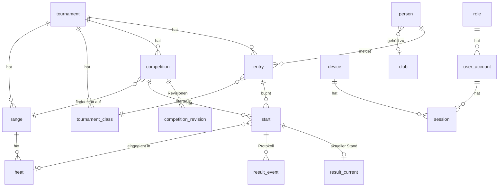

# Datenmodell

Tabellen und Felder heißen im Code englisch, die Oberfläche spricht deutsch. Diese Seite ist die gemeinsame Vorgabe für alle Kernmodule. Änderungen bitte erst hier, dann im Code.



## Begriffe

| Deutsch | Tabelle | Bedeutung |
|---|---|---|
| Turnier | `tournament` | eine Veranstaltung |
| Schießstand | `range` | Anlage mit nummerierten Schützenständen (`lane_count`) |
| Wettbewerb | `competition` | eine Disziplin innerhalb eines Turniers |
| Klasse | `tournament_class` | Wettbewerbsklasse im Turnier |
| Person | `person` | Teilnehmer-Stammdaten, turnierübergreifend |
| Verein | `club` | Verein einer Person |
| Anmeldung | `entry` | Person in einem Turnier, trägt die Startnummer |
| Start | `start` | ein gebuchter Start in einem Wettbewerb |
| Durchgang | `heat` | Zeitfenster auf einem Schießstand (nur bei Zeitplan) |

Alle Tabellen haben `id` (UUID), `created_at`, `updated_at`. Geld steht in Cent (`*_cents`, Integer). Zeiten von Schießleistungen stehen in Hundertstelsekunden (`*_cs`, Integer). Zeitstempel vergibt nur der Server (UTC).

## Turnier

**`tournament`**: `name`, `organizer`, `date_from`, `date_to`, `status` (`draft`, `active`, `closed`), `template` (`open`, `club_championship`, `custom`), `settings` (JSONB), `is_practice`, `practice_data` (JSONB).

`is_practice` kennzeichnet das Übungsturnier mit Beispieldaten (`POST /tournaments/practice`, Beispieldaten in `backend/app/modules/turnier/practice.yaml`). Es gibt höchstens eines (eindeutiger Teilindex); die Kennzeichnung steht beim Anlegen fest, ein Trigger weist spätere Änderungen ab. Oberfläche und Exporte zeigen es als „Übung“. `practice_data` (nur beim Übungsturnier) nennt die Personen und Vereine, die es angelegt hat: `{"person_ids": […], "club_ids": […]}`. Die Übungspersonen tragen die Mitgliedsnummer `ÜBUNG-<n>`, haben wie alle Personen kein Geburtsdatum und gehören zu erkennbar erfundenen Vereinen. `DELETE /tournaments/{id}` entfernt das Übungsturnier in jedem Status samt Anmeldungen, Starts, Durchgängen, Ergebnissen (auch `result_event`, siehe dort), seinen Audit-Einträgen und den Übungspersonen und -vereinen; wer inzwischen in einem anderen Turnier gemeldet ist oder einem Verein mit echten Personen angehört, bleibt.

**Kopie** (`POST /tournaments/{id}/copy`): übernimmt Einstellungen, Ausschreibung (Meldeschluss um denselben Abstand verschoben wie der Beginn), Schießstände, Klassen samt Zusammenlegung und Wettbewerbe mit `definition`, Startgeld und Mehrfachstart; jeder Wettbewerb beginnt mit Revision 1 (Grund „Kopiert aus dem Turnier …“). Anmeldungen, Starts, Durchgänge und Ergebnisse kommen nicht mit. **Vorlagen** (`GET /tournament-templates`, `POST /tournaments/from-template`) sind YAML-Dateien in `backend/app/modules/turnier/templates/` und verweisen nur über Verband und Kennziffer auf den Katalog; die Wettbewerbe entstehen beim Anlegen frisch aus dem aktuellen Katalog.

`settings` enthält alles, was kein eigenes Feld braucht, zum Beispiel `protest_minutes` (Einspruchsfrist, `null` = aus), `protest_restart_on_correction` (beginnt die Einspruchsfrist mit einer Korrektur neu? Standard `true`; bei `false` läuft sie ab dem Abschluss weiter), `timezone` (Ortszeit für Uhrzeiten in Listen und auf der Anzeige, IANA-Name, Standard `Europe/Berlin`), `currency`, `first_start_number` (erste vergebene Startnummer, Standard 1), Voreinstellungen für die Anzeige. Fehlt ein Schlüssel (ältere Turniere), gilt der Standard.

`announcement` (JSONB): Ausschreibung. `title`, `facts` (`venue`, `address`, `registration_deadline`, `registration_info`, `contact_name`, `contact_info`) und `blocks`, eine geordnete Liste aus `id`, `kind`, `heading`, `body`, `visible`. `kind` ist `text` (Freitext, kein HTML) oder ein automatischer Baustein `competitions`, `classes`, `fees`, `dates`, `ranges` (je höchstens einmal; Inhalt aus den Turnierdaten). Ein neues Turnier bekommt eine Standardgliederung mit leeren Texten; `null` bei älteren Turnieren heißt ebenfalls Standardgliederung.

**`range`**: `tournament_id`, `name`, `lane_count`, `sort`.

**`tournament_class`**: `tournament_id`, `code`, `name`, `short`, `sort`, `merge_into_id` (Zusammenlegung). Wird beim Anlegen aus dem Katalog kopiert und ist danach frei änderbar.

**`competition`**

| Feld | Bedeutung |
|---|---|
| `tournament_id`, `range_id`, `sort` | Zuordnung |
| `catalog_federation`, `catalog_code` | Herkunft aus dem Katalog, leer bei eigener Disziplin |
| `name` | Anzeigename |
| `definition` (JSONB) | Kopie von Ablauf-Variante und Wertung aus dem Katalog, im Turnier änderbar |
| `catalog_base` (JSONB) | die Katalogfassung, aus der `definition` stammt (beim Anlegen, beim Übernehmen per `reset-definition`, bei einer Kopie vom Original); leer bei eigener Disziplin |
| `capture_mode` | `shot` (Einzelschuss) oder `series` (Seriensumme) |
| `multi_start`, `max_starts` | Mehrfachstart erlaubt und wie oft |
| `multi_start_rule` | `best`, `first` oder `all` |
| `fee_first_cents`, `fee_repeat_cents` | Startgeld für den ersten und jeden weiteren Start |
| `class_ids`, `combined_ranking` | zugelassene Klassen, gemeinsame Wertung |
| `planning` | `queue` (Reihenfolge) oder `schedule` (Zeitplan) |
| `heat_minutes`, `changeover_minutes` | Dauer und Wechselzeit bei Zeitplan |
| `definition_revision` | aktuelle Revision der wertungsrelevanten Felder |

`definition` ist eine Kopie, kein Verweis. Ein späteres Katalog-Update ändert laufende Turniere nicht; die API meldet es aber an jedem Wettbewerb (`catalog_changed`, je Abruf aus `catalog_base` und dem aktuellen Katalog berechnet). Bewusste Abweichungen im Turnier zählen dabei nicht. Jeder Wert ist im Turnier änderbar, auch nach dem Start. `source.variant_id` nennt die kopierte Katalog-Variante; damit lassen sich Abweichungen vom Katalog anzeigen („abweichend vom Sporthandbuch“). `serien_gewertet` in einem Abschnitt heißt: nur die ersten N Serien zählen, die übrigen gelten als gestrichen.

**`competition_revision`** (nur Einfügen): `competition_id`, `revision` (fortlaufend ab 1, eindeutig je Wettbewerb), `definition` (JSONB), `capture_mode`, `multi_start`, `max_starts`, `multi_start_rule`, `combined_ranking`, `changed_by`, `device_id`, `reason`, `created_at`. Jede Änderung an diesen Feldern legt eine Revision an, schreibt einen Audit-Eintrag und meldet `competition.definition_changed`. Ist das Turnier `active`, ist `reason` Pflicht.

## Teilnehmer

**`club`**: `name`, `short`.

**`person`**: `name_enc`, `member_no_enc`, `club_id`, `display_mode` (`full`, `short`, `hidden`), `show_club`.

Felder mit `_enc` sind verschlüsselt (BYTEA, AES-GCM, siehe `app/core/crypto.py`). Es gibt kein Geburtsdatum und kein Geburtsjahr. Gesucht wird im Arbeitsspeicher des Servers über die entschlüsselten Namen; bei einigen hundert Personen ist das unkritisch.

**`entry`**: `tournament_id`, `person_id`, `start_number` (eindeutig je Turnier), `class_id`.

## Starts

**`start`**

| Feld | Bedeutung |
|---|---|
| `entry_id`, `competition_id` | wer, worin |
| `attempt` | laufende Nummer bei Mehrfachstart (1, 2, 3) |
| `fee_cents` | zu zahlender Betrag für diesen Start |
| `status` | `registered`, `called`, `captured`, `final`, `aborted` |
| `abort_reason` | `dns` (nicht angetreten), `dnf` (aufgegeben), `dsq` (disqualifiziert) |
| `queue_position` | Platz in der Reihenfolge des Schießstands |
| `heat_id`, `lane` | Durchgang (nur Zeitplan) und Schützenstand |
| `on_lane` | steht gerade auf `lane` und belegt sie (siehe unten) |
| `called_at` | Zeitpunkt des letzten Aufrufs; leer, solange der Start wartet (auch nach dem Zurückstellen) |

Erlaubte Statuswechsel:

| von | nach |
|---|---|
| `registered` | `called` (aufrufen), `captured` (nachträglich erfassen ohne Aufruf), `aborted` |
| `called` | `registered` (zurückstellen), `captured`, `aborted` |
| `captured` | `final`, `aborted` |
| `final` | `captured` (Wiederöffnen, verlangt einen Grund) |
| `aborted` | – |

`aborted` verlangt `abort_reason`. Ein Schützenstand ist belegt, solange ein Start mit `on_lane` darauf steht (über alle Wettbewerbe des Schießstands). `on_lane` setzt der Aufruf (`→ called`); es bleibt beim Erfassen (`called → captured`) stehen und fällt bei `final`, `aborted`, beim Zurückstellen (`→ registered`) oder über „Schützenstand freigeben“ (`POST …/starts/{id}/release-lane`, nur `captured`, Status bleibt). Ein Wiederöffnen (`final → captured`) belegt den Schützenstand nicht wieder. `lane` bleibt danach als Angabe stehen, wo geschossen wurde. Ein Start, der ohne Aufruf erfasst wird (`registered → captured`), belegt keinen Schützenstand: bei der Reihenfolge bleibt `lane` leer, beim Zeitplan steht der gebuchte Schützenstand nur als Angabe da. Eine Person steht höchstens auf einem Schützenstand. Ein Abbruch steht immer auch als Ereignis `aborted` im Ergebnisprotokoll, gleich über welchen Endpunkt er kam. Starts mit Ergebnis-Ereignissen lassen sich weder stornieren noch mit ihrer Anmeldung löschen.

**`heat`**: `range_id`, `number`, `starts_at`, `ends_at`.

**Reihenfolge der Startliste** (`GET …/startlist`, Anzeige, Export „nach Wettbewerb“): je Wettbewerb nach Durchgang (Uhrzeit, darin der gebuchte Schützenstand), sonst nach Platz in der Reihenfolge, dann Startnummer, dann Versuch. Der Schützenstand eines Starts ohne Durchgang ist nur der zuletzt benutzte und zählt für die Sortierung nicht; so steht der 1. Versuch einer Person immer vor ihrem 2.

**Volle Namen am Schießstand:** `GET …/startlist`, `…/ranges/{id}/queue` und `…/ranges/{id}/now` liefern Namen nach Anzeige-Einstellung. Mit `names=full` (nur mit `start.call`, `result.capture` oder `entry.read`, sonst 403) kommen `full_name` und `full_club` dazu; die öffentlichen Felder bleiben unverändert.

## Ergebnisse

Ergebnisse werden nie überschrieben.

**`result_event`** (nur Einfügen, ein Trigger weist UPDATE und DELETE ab; einzige Ausnahme: DELETE von Ereignissen zu Starts des Übungsturniers, damit es sich entfernen lässt): `start_id`, `seq` (fortlaufend je Start ab 1), `type`, `payload` (JSONB), `reason`, `user_id`, `device_id`, `idempotency_key` (vom Client, eindeutig je Start), `request_hash` (SHA-256 über Vorgang und Inhalt, erkennt Wiederholungen mit anderem Inhalt), `created_at`.

| `type` | Bedeutung |
|---|---|
| `raw_set` | Rohwerte eingegeben oder geändert, solange der Start offen ist |
| `finalized` | Ergebnis abgeschlossen |
| `corrected` | Korrektur nach dem Abschluss, `reason` ist Pflicht; `payload.protest_restarted` sagt, ob die Einspruchsfrist neu begann. An einem abgebrochenen Start mit `payload.final: false`: nur neue Rohwerte, der Start bleibt abgebrochen |
| `reopened` | Abschluss zurückgenommen, `reason` ist Pflicht |
| `aborted` | Start abgebrochen |
| `abort_undone` | Abbruch zurückgenommen, `reason` ist Pflicht; `payload.undone_abort_reason` (dns, dnf, dsq) und `payload.status` (zurück auf `captured` oder `registered`) |

**`result_current`**: `start_id`, `competition_id`, `raw` (JSONB), `computed` (JSONB), `score`, `rank_keys` (JSONB), `is_final`, `finalized_at`, `provisional_until`, `last_seq` (Nummer des letzten Ereignisses), `definition_revision` (Revision der Wertung, mit der gerechnet wurde), `needs_review` und `review_reason` (abgeschlossen, aber nach einer Änderung der Wertung unvollständig oder nicht wertbar).

`result_current` wird in derselben Transaktion wie das Ereignis geschrieben und lässt sich jederzeit aus den Ereignissen neu aufbauen.

**Reihenfolge der Eingaben:** Jeder schreibende Vorgang außer dem Abbruch verlangt `base_seq` (die letzte bekannte `seq`, beim Wiederöffnen optional); weicht sie ab, antwortet der Server mit 409 und dem aktuellen Stand (`current`), nichts wird geschrieben. Gleichzeitige Anfragen werden über Zeilensperren nacheinander abgearbeitet; von zwei Anfragen mit demselben `base_seq` geht genau eine durch. Derselbe `Idempotency-Key` mit demselben Inhalt liefert den aktuellen Stand ohne neues Ereignis, mit anderem Inhalt 422. `POST …/finalize` nimmt zusätzlich `expected_seq` und `expected_score` (der Stand, den der Mensch bestätigt hat); weicht der Server ab, 409 ohne Abschluss.

**Rangliste** (`GET …/competitions/{id}/ranking`, dieselbe Regel für Anzeige und Export, `RankPolicy.for_list` in `app.scoring`):

- Abgebrochene Starts (`dns`, `dnf`, `dsq`) bekommen nie einen Platz und stehen nie vor gewerteten Ergebnissen, gleich ob ihr Teilergebnis nach der Wertungsrichtung besser wäre. Sie stehen am Ende ihrer Gruppe ohne Platz (`group: unranked`, `abort_reason`), in der Reihenfolge aufgegeben, nicht angetreten, disqualifiziert. `include_aborted=false` lässt sie weg. Voreinstellung: aufführen (Rangliste, Export); auf dem Bildschirm nur mit der Option `show_aborted` der Ansicht (Standard aus).
- `scope=final`: Ein unvollständiges Ergebnis (etwa nach einer Änderung der Wertung) steht ohne Platz da. `scope=live`: unvollständige (laufende) stehen mit Platz hinter allen vollständigen.
- Mehrfachstart: Ein abgebrochener Versuch wird nie einem gewerteten oder laufenden vorgezogen (`best` und `first`). Wer nur abgebrochene Versuche hat, steht einmal am Ende.
- Der Export zeigt bei Abgebrochenen kein Ergebnis, nur den Grund.

### Rohwerte

`raw` folgt den Abschnitten der Disziplin:

```json
{
  "sections": {
    "fallscheibe": {
      "series": [
        { "time_cs": 1284, "standing": 1 },
        { "time_cs": 990, "standing": 0 }
      ]
    },
    "praezision": {
      "series": [
        { "shots": [10, 9, 9, "X", 8] },
        { "sum": 92, "tens": 3, "inner_tens": 1 }
      ]
    }
  }
}
```

- `shots`: Ringwerte 0 bis 10, `"X"` ist ein Innenzehner.
- `sum`: Seriensumme, wenn nicht einzeln erfasst wird; `tens` und `inner_tens` optional für den Gleichstand.
- `time_cs`: gemessene Zeit in Hundertstelsekunden, größer 0. Braucht der Status keine gemessene Zeit (Zeitlimit, Abbruch, Störung), wird eine 0 ignoriert. **Plausibilität:** Eine gemessene Zeit, die zählt, darf höchstens das Dreifache des Zeitlimits betragen (`max_zeit_je_serie_s` bzw. `max_gesamtzeit_s` für die Gesamtzeit), ohne Limit höchstens 3600 s; darüber ist es ein Fehler („Serie 2: 9999,00 s ist unplausibel – höchstens 180 s; …“). Je Abschnitt überschreibbar mit `zeit_plausibel_faktor` (ab 1) oder `zeit_plausibel_max_s` (feste Grenze). Die Eingabemaske nennt die Grenze als `max` des Zeitfelds. Gespeicherte Ergebnisse über der Grenze werden bei der nächsten Neuberechnung „prüfen“ (`needs_review`), nicht unlesbar. Zwischen Zeitlimit und Grenze gibt es nur eine Warnung.
- `standing`: stehende Scheiben.
- `status` je Serie, optional: `normal` (Standard), `unfinished` (nicht beendet), `time_limit` (Zeitlimit erreicht), `aborted_by_shooter` (vom Schützen abgebrochen), `malfunction_before_first_shot` (Waffenstörung vor dem ersten Wertungsschuss). Die Wertung setzt dafür die Katalogwerte ein, etwa `zeit_bei_abbruch_s` oder `zuschlag_stoerung_vor_erstem_schuss_s`.
- `time_cs` auf Abschnittsebene (neben `series`): Gesamtzeit eines Parcours mit Sollzeit (`sollzeit_s`).
- Gestrichene Serien: Ist `serien_gewertet` gesetzt, werden alle Serien erfasst, gewertet aber nur die ersten N.

`computed` enthält Zwischensummen je Serie und Abschnitt, Zuschläge, Abzüge und das Endergebnis. `rank_keys` ist die Liste der Vergleichswerte für die Rangfolge einschließlich Gleichstand.

## Anmeldung und Rechte

**`role`**: `name`, `permissions` (Liste), `is_system`, `starter_key` (Startrolle, aus der die Rolle entstand), `customized` (Rechte von Hand geändert). Fünf Rollen sind vorbelegt: Administrator, Turnierleitung, Kasse, Auswertung, Anzeige. Weitere lassen sich anlegen. Beim Start bekommen Startrollen, die nie von Hand geändert wurden, die aktuelle Zuordnung; veraltete Berechtigungen (genaue Namen aus einem Bereich, den ein Modul führt, die es dort nicht mehr gibt) fallen aus allen Rollen. Beides steht im Audit-Protokoll.

**`user_account`**: `name`, `pin_hash`, `role_id`, `active`.

**`device`**: `name`, `token_hash`, `paired_at`, `last_seen_at`, `default_role_id`.

**`session`**: `device_id`, `user_id`, `expires_at`.

Berechtigungen sind Texte wie `tournament.edit`, `entry.edit`, `result.capture`, `result.correct`, `display.control`, `system.manage`. Jedes Modul bringt seine eigenen mit.

## System

**`setting`**: `key`, `value` (JSONB). Globale Einstellungen, zum Beispiel Sicherung und Anzeige.

**`backup_run`**: `started_at`, `finished_at`, `kind` (`snapshot`, `journal`), `target` (`local`, `usb`), `file_name`, `size_bytes`, `sha256`, `ok`, `error`.

**`audit_log`**: `at`, `user_id`, `device_id`, `action`, `entity`, `entity_id`, `details` (JSONB). Für Änderungen an Turnier-Einstellungen, Rollen, Anmeldungen und Starts. Ergebnisvorgänge stehen zusätzlich zum Ergebnisprotokoll hier, damit das System-Protokoll sie zeigt: `result.finalized`, `result.corrected`, `start.reopened`, `start.aborted`, `start.abort_undone`, `result.recomputed`; ebenso Änderungen am Ablauf am Schießstand: `start.moved`, `start.returned`, `start.lane_released`, `start.slot_assigned`, `start.slot_cleared`, `heat.created`, `heat.updated`, `heat.deleted`. `details` nennt Startnummer, Versuch, Kennziffer und Name des Wettbewerbs, Grund und Ergebnis, nie den Namen der Person.

Die Katalog-Tabellen (`catalog_*`) werden beim Start aus `catalog/` gefüllt und sind in der App nur lesbar.
