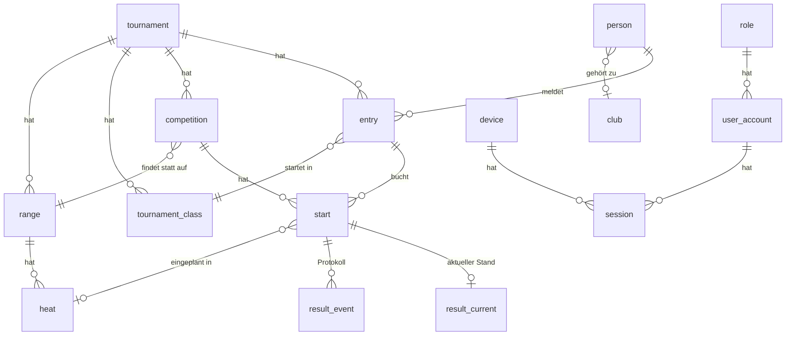

# Datenmodell

Tabellen und Felder heißen im Code englisch, die Oberfläche spricht deutsch. Diese Seite ist die gemeinsame Vorgabe für alle Kernmodule. Änderungen bitte erst hier, dann im Code.



## Begriffe

| Deutsch | Tabelle | Bedeutung |
|---|---|---|
| Turnier | `tournament` | eine Veranstaltung |
| Stand | `range` | Schießstand mit nummerierten Bahnen |
| Wettbewerb | `competition` | eine Disziplin innerhalb eines Turniers |
| Klasse | `tournament_class` | Wettbewerbsklasse im Turnier |
| Person | `person` | Teilnehmer-Stammdaten, turnierübergreifend |
| Verein | `club` | Verein einer Person |
| Anmeldung | `entry` | Person in einem Turnier, trägt die Startnummer |
| Start | `start` | ein gebuchter Start in einem Wettbewerb |
| Durchgang | `heat` | Zeitfenster auf einem Stand (nur bei Zeitplan) |

Alle Tabellen haben `id` (UUID), `created_at`, `updated_at`. Geld steht in Cent (`*_cents`, Integer). Zeiten von Schießleistungen stehen in Hundertstelsekunden (`*_cs`, Integer). Zeitstempel vergibt nur der Server (UTC).

## Turnier

**`tournament`**: `name`, `organizer`, `date_from`, `date_to`, `status` (`draft`, `active`, `closed`), `template` (`open`, `club_championship`, `custom`), `settings` (JSONB).

`settings` enthält alles, was kein eigenes Feld braucht, zum Beispiel `protest_minutes` (Einspruchsfrist, `null` = aus), `currency`, Voreinstellungen für die Anzeige.

**`range`**: `tournament_id`, `name`, `lane_count`, `sort`.

**`tournament_class`**: `tournament_id`, `code`, `name`, `short`, `sort`, `merge_into_id` (Zusammenlegung). Wird beim Anlegen aus dem Katalog kopiert und ist danach frei änderbar.

**`competition`**

| Feld | Bedeutung |
|---|---|
| `tournament_id`, `range_id`, `sort` | Zuordnung |
| `catalog_federation`, `catalog_code` | Herkunft aus dem Katalog, leer bei eigener Disziplin |
| `name` | Anzeigename |
| `definition` (JSONB) | Kopie von Ablauf-Variante und Wertung aus dem Katalog, im Turnier änderbar |
| `capture_mode` | `shot` (Einzelschuss) oder `series` (Seriensumme) |
| `multi_start`, `max_starts` | Mehrfachstart erlaubt und wie oft |
| `multi_start_rule` | `best`, `first` oder `all` |
| `fee_first_cents`, `fee_repeat_cents` | Startgeld für den ersten und jeden weiteren Start |
| `class_ids`, `combined_ranking` | zugelassene Klassen, gemeinsame Wertung |
| `planning` | `queue` (Reihenfolge) oder `schedule` (Zeitplan) |
| `heat_minutes`, `changeover_minutes` | Dauer und Wechselzeit bei Zeitplan |

`definition` ist eine Kopie, kein Verweis. Ein späteres Katalog-Update ändert laufende Turniere nicht.

## Teilnehmer

**`club`**: `name`, `short`.

**`person`**: `name_enc`, `member_no_enc`, `club_id`, `display_mode` (`full`, `short`, `hidden`), `show_club`.

Felder mit `_enc` sind verschlüsselt. Es gibt kein Geburtsdatum und kein Geburtsjahr. Gesucht wird im Arbeitsspeicher des Servers über die entschlüsselten Namen; bei einigen hundert Personen ist das unkritisch.

**`entry`**: `tournament_id`, `person_id`, `start_number` (eindeutig je Turnier), `class_id`.

## Starts

**`start`**

| Feld | Bedeutung |
|---|---|
| `entry_id`, `competition_id` | wer, worin |
| `attempt` | laufende Nummer bei Mehrfachstart (1, 2, 3) |
| `fee_cents` | zu zahlender Betrag für diesen Start |
| `status` | `registered`, `called`, `captured`, `final`, `aborted` |
| `abort_reason` | `dns` (nicht angetreten), `dnf` (aufgegeben), `dsq` (disqualifiziert) |
| `queue_position` | Platz in der Reihenfolge des Stands |
| `heat_id`, `lane` | Durchgang (nur Zeitplan) und Bahn |

**`heat`**: `range_id`, `number`, `starts_at`, `ends_at`.

## Ergebnisse

Ergebnisse werden nie überschrieben.

**`result_event`** (nur Einfügen): `start_id`, `seq`, `type`, `payload` (JSONB), `reason`, `user_id`, `device_id`, `created_at`.

| `type` | Bedeutung |
|---|---|
| `raw_set` | Rohwerte eingegeben oder geändert, solange der Start offen ist |
| `finalized` | Ergebnis abgeschlossen |
| `corrected` | Korrektur nach dem Abschluss, `reason` ist Pflicht |
| `reopened` | Abschluss zurückgenommen, `reason` ist Pflicht |
| `aborted` | Start abgebrochen |

**`result_current`**: `start_id`, `raw` (JSONB), `computed` (JSONB), `score`, `rank_keys` (JSONB), `is_final`, `finalized_at`, `provisional_until`.

`result_current` wird in derselben Transaktion wie das Ereignis geschrieben und lässt sich jederzeit aus den Ereignissen neu aufbauen.

### Rohwerte

`raw` folgt den Abschnitten der Disziplin:

```json
{
  "sections": {
    "fallscheibe": {
      "series": [
        { "time_cs": 1284, "standing": 1 },
        { "time_cs": 990, "standing": 0 }
      ]
    },
    "praezision": {
      "series": [
        { "shots": [10, 9, 9, "X", 8] },
        { "sum": 92, "tens": 3, "inner_tens": 1 }
      ]
    }
  }
}
```

- `shots`: Ringwerte 0 bis 10, `"X"` ist ein Innenzehner.
- `sum`: Seriensumme, wenn nicht einzeln erfasst wird; `tens` und `inner_tens` optional für den Gleichstand.
- `time_cs`: gemessene Zeit. `standing`: stehende Scheiben.

`computed` enthält Zwischensummen je Serie und Abschnitt, Zuschläge, Abzüge und das Endergebnis. `rank_keys` ist die Liste der Vergleichswerte für die Rangfolge einschließlich Gleichstand.

## Anmeldung und Rechte

**`role`**: `name`, `permissions` (Liste), `is_system`. Fünf Rollen sind vorbelegt: Administrator, Turnierleitung, Kasse, Auswertung, Anzeige. Weitere lassen sich anlegen.

**`user_account`**: `name`, `pin_hash`, `role_id`, `active`.

**`device`**: `name`, `token_hash`, `paired_at`, `last_seen_at`, `default_role_id`.

**`session`**: `device_id`, `user_id`, `expires_at`.

Berechtigungen sind Texte wie `tournament.edit`, `entry.create`, `result.capture`, `result.correct`, `display.control`, `system.manage`. Jedes Modul bringt seine eigenen mit.

## System

**`setting`**: `key`, `value` (JSONB). Globale Einstellungen, zum Beispiel Sicherung und Anzeige.

**`backup_run`**: `started_at`, `kind` (`snapshot`, `journal`), `target` (`local`, `usb`), `size_bytes`, `ok`, `error`.

**`audit_log`**: `at`, `user_id`, `device_id`, `action`, `entity`, `entity_id`, `details` (JSONB). Für alles außerhalb der Ergebnisse, zum Beispiel Änderungen an Turnier-Einstellungen oder Rollen.

Die Katalog-Tabellen (`catalog_*`) werden beim Start aus `catalog/` gefüllt und sind in der App nur lesbar.
